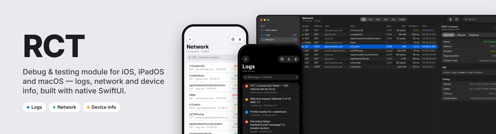


**RCT** is a Swift package that helps you debug an app during test phases.
Shake the device (or call one method) and get, inside your app:

- **Logs** sent with `rct_log`, filterable by level and searchable
- **Network** calls made through `URLSession`: status, timing, headers, bodies, cURL export
- **Information** about the app and the device, shareable as a report

The interface is built with **native SwiftUI components** and system colors, so it
follows Apple's Human Interface Guidelines and adapts to light and dark mode,
Dynamic Type and Liquid Glass on each platform.

| | iPhone | iPad | Mac |
|---|---|---|---|
| Presentation | Sheet | Full screen | Separate window |
| Navigation | Tab bar | Three-column split view | Sidebar + inspector |
| Requests & logs | Lists with search and filter menu | Lists with selection and detail column | Sortable tables with context menus |
| Details | Pushed form | Detail column | Inspector |

## Screenshots

> Design previews of the native interface.

### iPhone

| Network | Request | Response | Logs | Information |
|---|---|---|---|---|
| 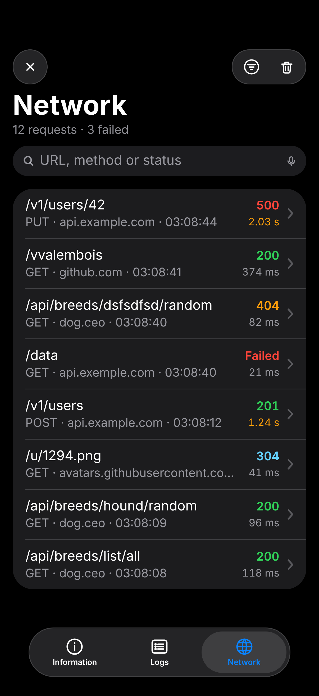 | 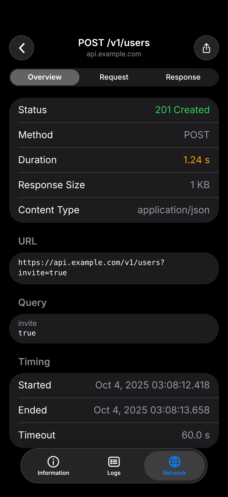 | 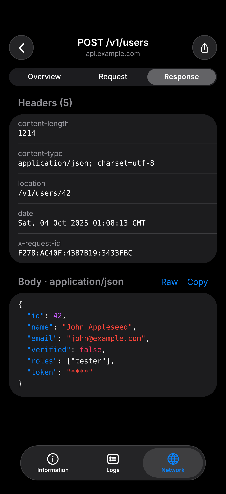 | 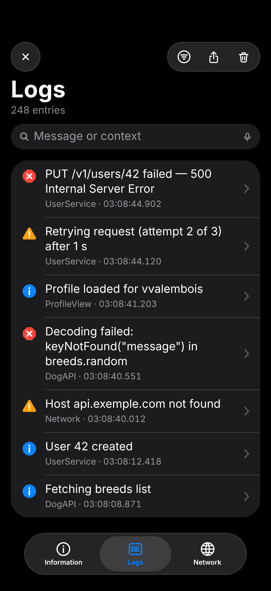 | 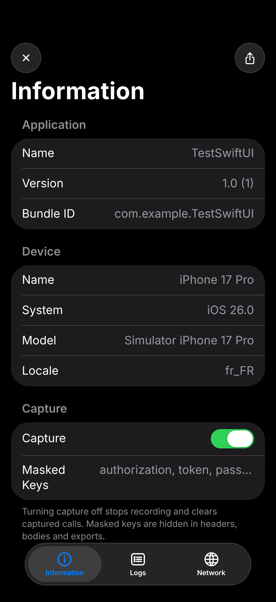 |
| 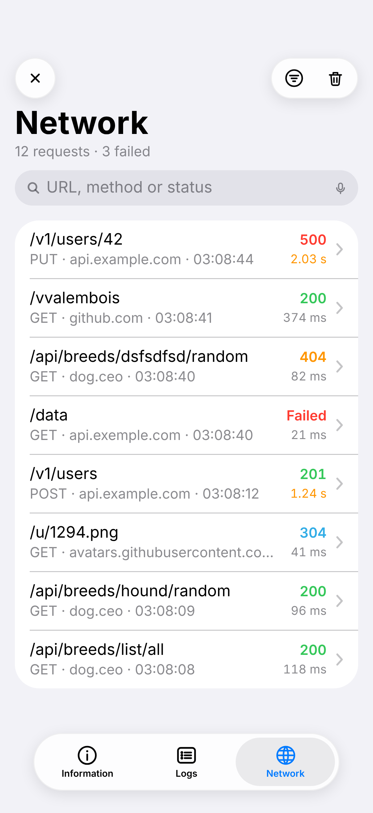 | 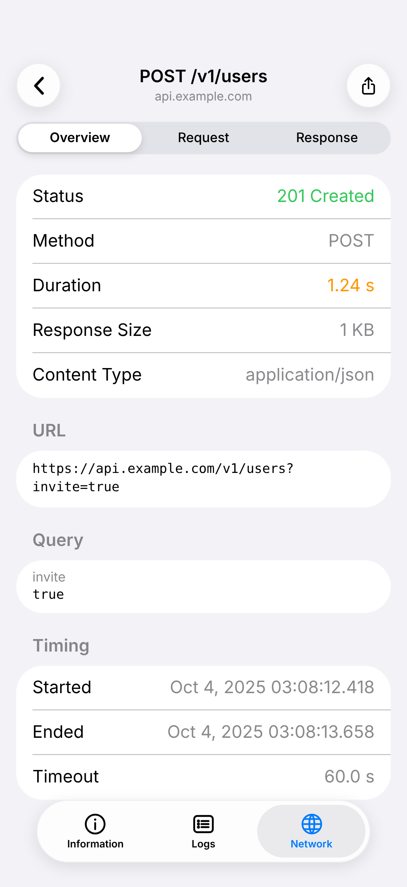 | 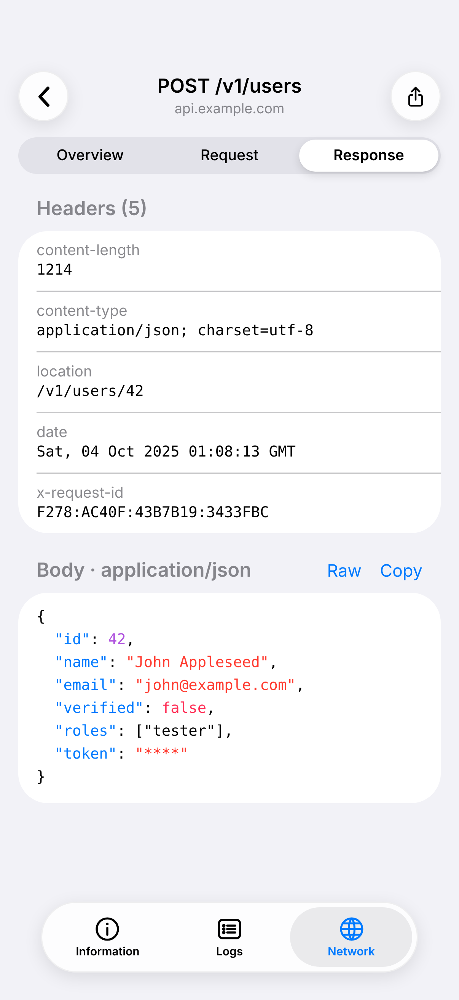 | 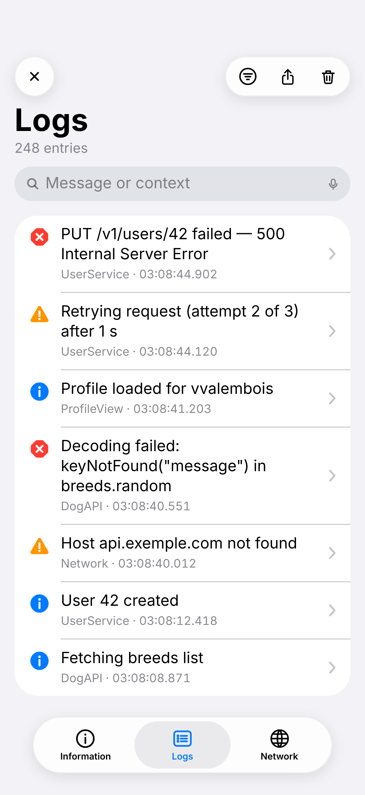 | 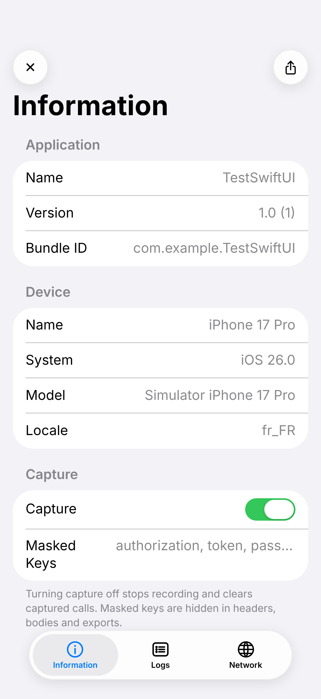 |

### iPad

| Dark | Light |
|---|---|
| 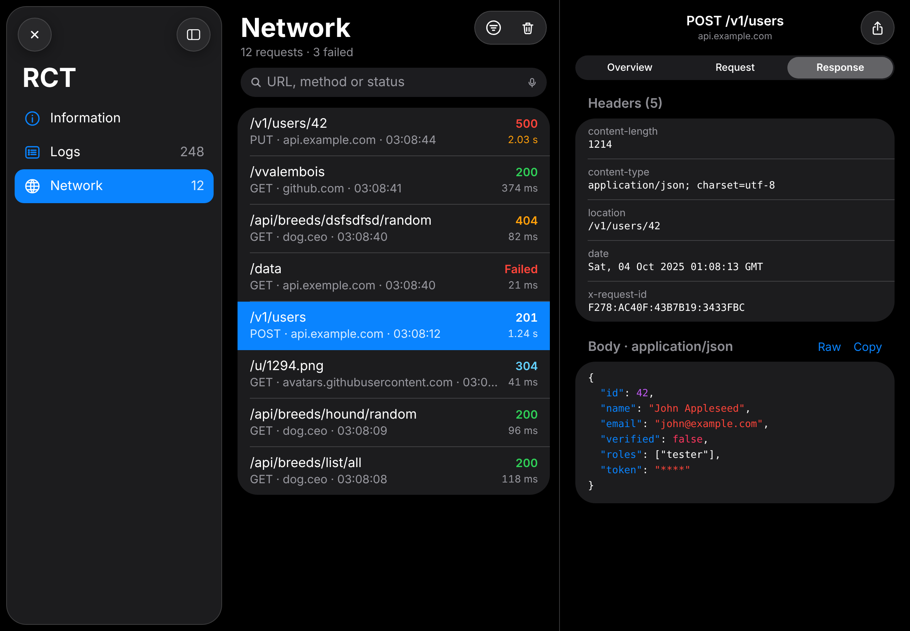 | 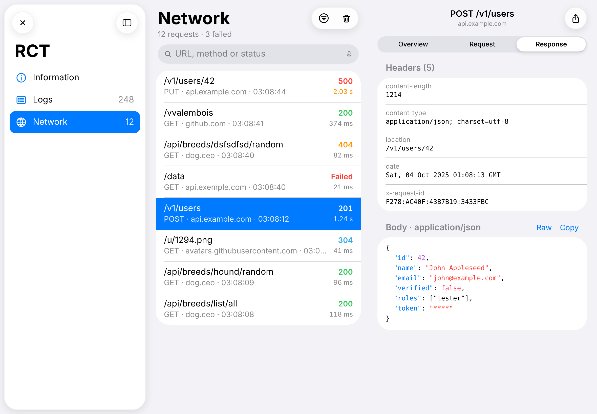 |

### Mac

| Network | Logs |
|---|---|
| 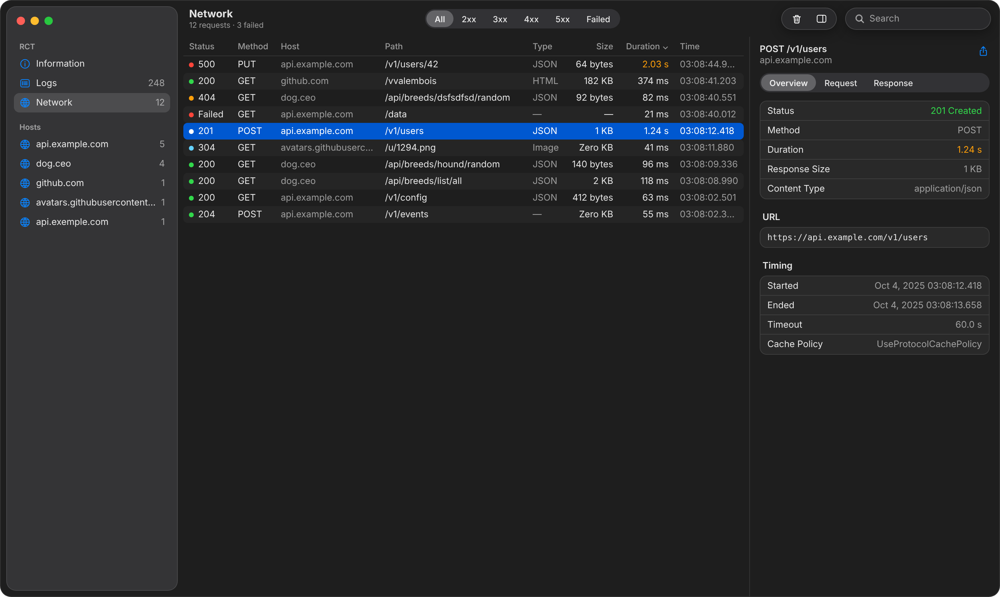 | 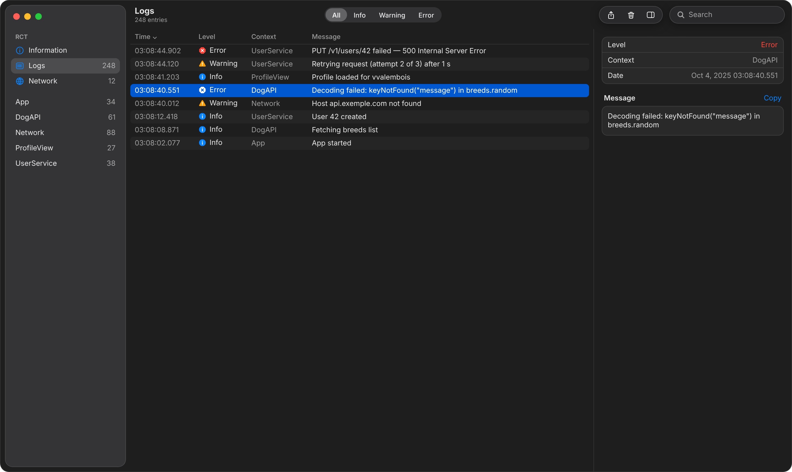 |
| 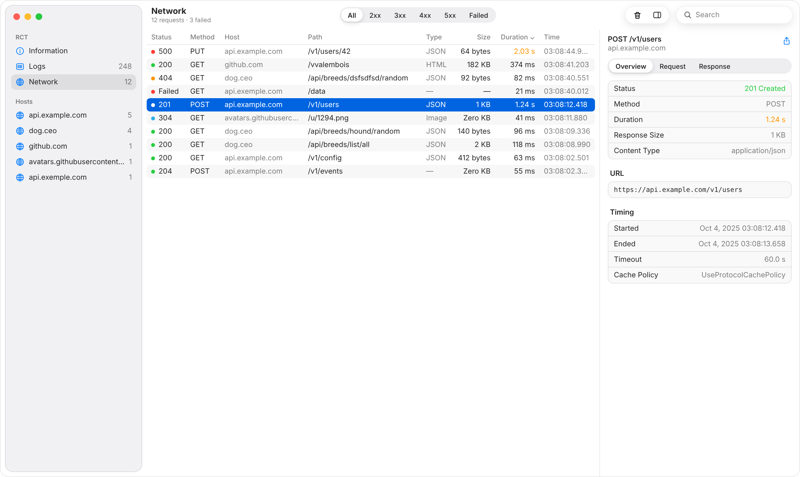 | 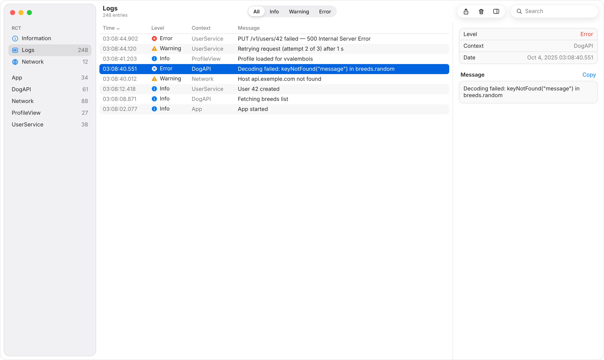 |

## Requirements

- Swift 6.1+ / Xcode 16+ (Xcode 26 to get Liquid Glass and navigation subtitles on iOS 26)
- iOS / iPadOS 16+
- macOS 14+

## Installation

RCT is distributed with the Swift Package Manager.

In Xcode: **File › Add Package Dependencies…** and enter `https://github.com/vvalembois/rct`.

Or in a `Package.swift`:

```swift
dependencies: [
    .package(url: "https://github.com/vvalembois/rct", from: "1.0.0")
],
targets: [
    .target(
        name: "MyApp",
        dependencies: [
            .product(name: "RCT", package: "rct")
        ]
    )
]
```

## Quick Start

Start RCT once, as early as possible (debug builds only):

```swift
import SwiftUI
import RCT

@main
struct DemoApp: App {

    init() {
        #if DEBUG
        RCT.sharedInstance().start()
        RCT.sharedInstance().setSensitiveKeys(["authorization", "token", "password"])
        #endif
    }

    var body: some Scene {
        WindowGroup {
            ContentView()
                .onAppear {
                    rct_log(.info, message: "App started")
                }
        }
    }
}
```

On **iPhone and iPad**, shake the device to open or close RCT.

On **Mac**, there is no shake gesture: add a menu command (or a button) that toggles RCT:

```swift
WindowGroup {
    ContentView()
}
.commands {
    #if DEBUG
    CommandMenu("Debug") {
        Button("Show RCT") {
            RCT.sharedInstance().toggleRCT()
        }
        .keyboardShortcut("d", modifiers: [.command, .option])
    }
    #endif
}
```

## Usage

### Logs

```swift
rct_log(.info, message: "User signed in")
rct_log(.warning, context: self, message: "Token expires soon")
rct_log(.error, context: self, message: "Decoding failed: \(error)")
```

- Levels: `.info`, `.warning`, `.error`.
- `context` is any object: its type name is shown as the log context (`UserService`, `ProfileView`…).
- Logs are also forwarded to the unified logging system (`Logger`), so they appear in Xcode and Console.
- Logs are kept between launches; they are only recorded while RCT is started.

### Network

Once `start()` is called, requests are captured automatically for:

- `URLSession.shared`
- every session created from `URLSessionConfiguration.default` or `.ephemeral`
  (your own API client, Alamofire, Moya…), as long as the session is created **after** `start()`

A session copies its configuration when it is created, so for a session created before
`start()`, or from a configuration built another way, enable capture explicitly before
creating the session:

```swift
let configuration = URLSessionConfiguration.default
RCT.sharedInstance().enableCapture(on: configuration)
let session = URLSession(configuration: configuration)
```

Not captured: background sessions (`URLSessionConfiguration.background`), `WKWebView`
loads and WebSockets.

For each call RCT shows the status, method, URL, query, timing, headers and body
(JSON is pretty-printed and highlighted, HTML can be previewed, images are displayed).
A call can be copied or shared as **cURL** or as a full text log.

Values of the keys passed to `setSensitiveKeys(_:)` are replaced by `****` in headers,
bodies and exports.

### Information

Application name, version, build and bundle identifier, device or Mac model and
system version, plus a toggle to turn capture on or off. The whole screen can be shared
as a text report.

## API

| Method | Description |
|---|---|
| `RCT.sharedInstance().start()` | Starts log recording and network capture |
| `RCT.sharedInstance().stop()` | Stops recording and clears captured calls |
| `RCT.sharedInstance().showRCT()` | Opens the interface |
| `RCT.sharedInstance().hideRCT()` | Closes the interface |
| `RCT.sharedInstance().toggleRCT()` | Opens or closes the interface |
| `RCT.sharedInstance().setSensitiveKeys(_:)` | Keys whose values are masked |
| `RCT.sharedInstance().enableCapture(on:)` | Captures sessions created from a given configuration |
| `rct_log(_:context:message:)` | Records a log entry |

## Design System

The screens are built on `RCTUI`, the package's design system (`Sources/UI`):

- **Tokens**: semantic tones mapped to system colors (`DSTone`), spacing, monospaced text styles
- **Formatting**: durations, sizes, times and HTTP statuses formatted the same way everywhere (`DSFormat`), JSON highlighting
- **Components**: list rows, key/value rows, status text, tone icons, code blocks, empty states, filters, web view
- **Catalog**: `DSCatalogView` previews every component in light, dark and accessibility sizes

See [Sources/UI/README.md](Sources/UI/README.md) for the principles and the platform mapping.

## Project Structure

```
Sources/
├── RCT/
│   ├── RCT.swift                 Public entry point (start, show, hide…)
│   ├── commons/                  Extensions, persistence, platform helpers
│   └── features/
│       ├── root/                 Navigation per platform (tabs, split view, Mac window)
│       ├── information/          App and device information
│       ├── log/                  Logs: model, filters, repository, list, table, detail
│       └── network/              Capture (URLProtocol), model, filters, list, table, detail
└── UI/                           RCTUI design system
Tests/
└── RCTTests/                     Unit tests (RCT and RCTUI)
```

## Tests

```bash
swift test
```

or, to run them on an iOS simulator:

```bash
xcodebuild test -scheme RCT -destination "platform=iOS Simulator,name=iPhone 17 Pro"
```

## CI & Release

GitHub Actions run on the `xcode-27` image:

- **CI** (`ci.yml`, on pushes and pull requests to `main` / `develop`): SwiftLint, then the unit tests on macOS (`swift test`) and on an iOS simulator, with a coverage report.
- **Release** (`release.yml`, run manually): creates the next semver tag (next minor version, or the version given as input), then builds the SPM source archives (`.tar.gz` and `.zip`) and attaches them to the GitHub release.

## License

RCT is available under the MIT license. See [LICENSE](LICENSE).

## Author

Vincent Valembois
